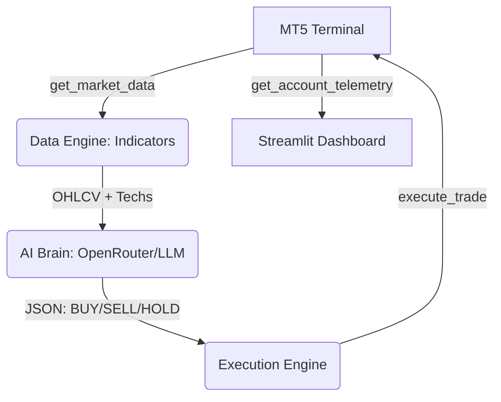

# AI Trading Bot Architecture Audit Report

This document provides a comprehensive technical and business overview of the current trading bot architecture, based on an analysis of the existing codebase (`app.py`, `data_engine.py`, `execution.py`, `ai_brain.py`, `config.py`).

## 1. Project Overview

**Project Name:** My Hedge Fund (Autonomous AI Hedge Fund Terminal)
**Primary Purpose:** Autonomous forex/crypto trading combining quantitative technical analysis with LLM-based decision making.
**Current Version:** 1.0.0
**Development Status:** Prototype / Beta
**Supported Markets:** Forex, Crypto, Indices, Commodities, Stocks (Inherited from MT5 availability)
**Supported Brokers:** Any broker supporting MetaTrader 5
**Trading Platform:** MT5

## 2. Technology Stack

**Frontend:**
- **Framework:** Streamlit
- **Language:** Python 3.x
- **State Management:** Streamlit Session State (`st.session_state`)
- **UI Library:** Streamlit native components with heavy custom CSS injections
- **Chart Library:** Plotly (`plotly.graph_objects`)
- **CSS Framework:** Custom injected CSS (Dark Command Center theme)
- **Animation Library:** CSS Keyframes (e.g., Reactor pulse animations)

**Backend:**
- **Language:** Python 3.x
- **Framework:** None (Streamlit handles execution flow)
- **Database:** None currently (In-memory execution)
- **ORM:** N/A
- **Queue:** None (Synchronous execution pipeline)

**Real-Time Communication:**
- **Mechanism:** Polling (Streamlit `st.rerun()` or manual sync)

**Authentication:** None currently (Local execution)
**Deployment:** None (Runs locally via `run.bat` / Virtual Environment)

## 3. Current System Architecture

**Data Flow:**

## 4. MT5 / Broker Integration

**Broker Connection Method:** MT5 Terminal (via `MetaTrader5` Python library)
**Current Connection Stability:** High (handles IPC timeouts with retry logic in `initialize_mt5()`)
**Reconnect Logic:** Basic re-initialization attempt if offline.
**Execution Latency:** Dependent on local MT5 terminal ping to broker.
**Supported Order Types:** Market (Buy/Sell) via `ORDER_TYPE_BUY` and `ORDER_TYPE_SELL`.

## 5. Trading Engine

**Entry Logic:**
- **How does the bot decide when to BUY?:** The AI Brain (LLM) evaluates technical indicator data (RSI, ATR, EMA) and outputs a JSON decision.
- **Which indicators are used?:** RSI, ATR, EMA20, EMA50, MACD.
- **Which conditions must be true?:** The LLM internally evaluates the prompt conditions to return a "BUY" or "SELL" action.

**Exit Logic:**
- **Take Profit Logic:** Hardcoded fixed Pips (currently set to 2x Stop Loss in `app.py` execution call).
- **Stop Loss Logic:** User-defined Pip value from UI.
- **Manual Exit:** Yes (via "Close" per position or "EMERGENCY CLOSE ALL" button).
- **Auto Exit:** Handled by MT5 broker-side TP/SL orders.

**Signal Process:** AI-Based (LLM Integration).

## 6. Indicators Currently Implemented

- **EMA20:** Implemented (Used in `data_engine.py` & Chart)
- **EMA50:** Implemented (Used in `data_engine.py` & Chart)
- **EMA100:** Not Implemented
- **EMA200:** Not Implemented
- **RSI:** Implemented (14-period, used in `data_engine.py`)
- **MACD:** Implemented (Used in `data_engine.py`)
- **ATR:** Implemented (Used in `data_engine.py` for volatility)
- **ADX:** Not Implemented
- **VWAP:** Not Implemented
- **Bollinger Bands:** Not Implemented
- **Volume Profile:** Not Implemented
- **SuperTrend:** Not Implemented
- **Ichimoku:** Not Implemented
- **Stochastic:** Not Implemented
- **Market Structure / SMC Concepts:** Not Implemented

## 7. Symbol Discovery Capability

- **Trade only selected symbol?:** Yes (via UI Dropdown)
- **Scan watchlist?:** Yes (Categories defined in `get_available_symbols()`)
- **Scan all broker symbols?:** No
- **Multi-market scanning?:** No (Single selected symbol at a time)
- **Ranking system?:** No
- **Maximum symbols scanned simultaneously:** 1 (Synchronous pipeline on UI click)

## 8. Autonomous Trading Capability

**Current status:** Semi Auto Trading (Requires manual click of "SCAN & EXECUTE")

**Capabilities:**
- **Open trades automatically:** Yes (Once triggered)
- **Close trades automatically:** No (Relies on MT5 TP/SL)
- **Adjust stop losses:** No
- **Move to breakeven:** No
- **Apply trailing stops:** No
- **Partial profit booking:** No
- **Scale in/out:** No

## 9. Risk Management

**Current settings:**
- **Risk Per Trade:** Not dynamically calculated based on risk %.
- **Position Sizing Method:** Fixed Lot (Selected via UI).
- **Max Open Trades:** Uncapped.
- **Daily Loss Limit:** None.
- **Max Drawdown / Exposure:** Uncapped.
- **Slippage Protection:** Basic deviation parameter in `execution.py`.

## 10. Position Sizing Engine

**Current Method:** Fixed Lot
- User inputs a lot size (e.g., `0.01`) in the UI, which is directly passed to the `execute_trade` function.

## 11. Existing Dashboard Modules

- Account Summary (HUD Bar)
- Balance Widget (HUD Bar)
- Equity Widget (HUD Bar)
- P&L Monitor (HUD Bar)
- Position Table (Risk & Position Matrix)
- Chart Panel (Plotly Candlesticks + EMAs)
- AI Brain Reactor (Visual pulse + AI Signal Stats)
- Execution Console (Risk Matrix + Scan & Execute Button)
- Live Info Strip (Spread, Margin, Session Clock)

## 12. Real-Time Data Architecture

- **Delivery:** Polling (User clicks "Sync Feed" or Streamlit reruns on state change).
- **Refresh Interval:** Manual / Action-driven.
- **Data Frequency:** Tick-level available via MT5, but UI updates on demand.

## 13. AI Layer Analysis

**Current AI type:** LLM Integration
- **Model Used:** Configurable via `config.py` (e.g., OpenRouter / Groq API).
- **Training Data:** Pre-trained LLM.
- **Features:** Prompt-based reasoning using technical indicator DataFrame.
- **Inference Frequency:** On-demand (per "SCAN & EXECUTE" click).
- **Accuracy Statistics:** Not tracked.

## 14. Strategy Framework

**Available Strategies:** AI/LLM Discretionary (The LLM decides based on the prompt).
No rigid rule-based strategies (like pure MACD crossover) are currently isolated into separate classes.

## 15. Trade Journal

**Does system store:** No storage. Trades are sent to MT5; the app is stateless between restarts.
**Storage location:** None.

## 16. Backtesting System

**Current capabilities:** None implemented.

## 17. Performance Analytics

**Available metrics:** None calculated locally (relies on MT5 terminal history).

## 18. Current Limitations

- **Technical bottlenecks:** Synchronous Streamlit execution blocks UI during LLM API calls.
- **Execution bottlenecks:** LLM latency can delay trade entry by several seconds.
- **Performance bottlenecks:** Polling MT5 data requires full page re-renders.
- **Scalability limitations:** Single-threaded; cannot monitor multiple pairs concurrently.
- **Security concerns:** API keys stored in plaintext `config.py`.
- **Trading weaknesses:** No trailing stops, breakeven logic, or dynamic risk-based position sizing.

## 19. Feature Readiness Assessment

- **Autonomous Market Scanner:** Major Refactor Needed
- **Multi-Symbol Trading:** Major Refactor Needed
- **AI Confidence Engine:** Ready Now (Currently outputs confidence)
- **Strategy Marketplace:** Major Refactor Needed
- **Portfolio Manager:** Minor Changes Needed
- **Trade Journal:** Major Refactor Needed (Requires DB)
- **Advanced Analytics:** Major Refactor Needed
- **Risk Engine v2:** Minor Changes Needed
- **TradingView Charts:** Major Refactor Needed
- **Lightning Border UI:** Ready Now
- **WebSockets:** Major Refactor Needed (Streamlit limitation)
- **Mobile Dashboard:** Ready Now (Streamlit is responsive)
- **Paper Trading:** Ready Now (Via MT5 Demo Accounts)

## 20. Repository Analysis

**Project Structure:**
- `app.py`: Dashboard UI & Control Flow
- `data_engine.py`: Core Services (MT5 connection, technical indicators)
- `ai_brain.py`: AI Layer (Prompting, JSON extraction)
- `execution.py`: Trading Engine (Order routing, position closing)
- `config.py`: Credentials

## 21. Recommended Roadmap

**Top 10 improvements:**
1. Async execution pipeline (background threads) to prevent UI freezing during LLM calls.
2. Dynamic Risk-Based Position Sizing (Lot size based on account % risk and SL distance).
3. SQLite/PostgreSQL integration for Trade Journaling.
4. Continuous Background Scanner (monitoring a watchlist autonomously).
5. Implementation of SMC (Smart Money Concepts) indicators.
6. Trailing Stop / Breakeven logic execution loop.
7. Real-time auto-refresh mechanism (Streamlit `st_autorefresh`).
8. `.env` file implementation for secure credential storage.
9. Backtesting engine integration.
10. Multi-timeframe trend alignment logic in the AI prompt.

**Highest risk areas:** LLM hallucination leading to bad trades; execution latency during API calls.
**Must-fix bugs:** None critical, but Streamlit state management needs hardening for concurrent order tracking.

---

## Final Deliverable Scores

- **Current Capability Score:** 45/100
- **UI Score:** 85/100
- **Trading Logic Score:** 40/100
- **Risk Management Score:** 30/100
- **Scalability Score:** 20/100
- **Code Quality Score:** 75/100

**Priority Order for Next Version:**
1. **[P0 Critical]** Secure Credentials (`.env`) & Risk-Based Position Sizing.
2. **[P1 Important]** Background Market Scanner & Trade Journal Database.
3. **[P2 Nice To Have]** Backtesting Module & Trailing Stops.
