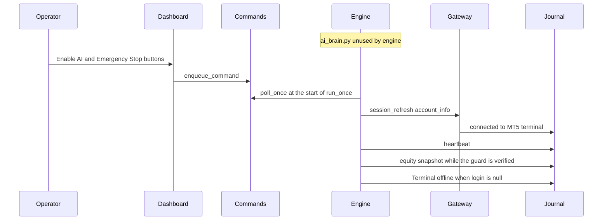

# Ownership Table

Runtime status for the process that is up on 2026-10-15: PID 44436,
started 18:53:46 local, command `python -u -m engine`, no `--live`.
`ai_brain.py` is unused by that process. `engine/brain.py` is not a file.

## Sequence

## Status of each connection

| Connection | Status | Evidence |
|---|---|---|
| Operator to Dashboard buttons | WIRED BUT NEVER EXERCISED | `enqueue_command` exists in `ui/components/enable_ai.py` and `ui/components/emergency_stop.py`. Commands since `2026-10-15T13:23:46+00:00`: 0. |
| Dashboard to commands table | WIRED BUT NEVER EXERCISED | Same enqueue sites. Last command rows are ENABLE_AI on 2026-10-13, before this run. |
| Engine loop to commands table | WIRED AND RUNNING | `Engine.run_once` calls `poll_once` first. Heartbeats continued, so `run_once` completed. |
| Engine loop to Gateway account read | WIRED AND RUNNING until 14:16:54, then stuck | Equity snapshots stop at id 31346. Later events say the terminal is offline. `gateway.status.connected` stays 1. `_ensure_connected` returns immediately when that flag is already true. |
| Gateway to Journal, startup connect line | WIRED AND RUNNING | Events 23623 and 23626, `connected to MT5 terminal`. Not written again after the outage. |
| Engine loop to Journal heartbeats | WIRED AND RUNNING | Rows continue. Ids 57478 then 57479 span `15:35:46` to `17:08:53` with no row between. |
| Engine loop to Journal equity | WIRED AND RUNNING, then stopped | `_write_telemetry` returns when `may_write_telemetry()` is false. Last equity id 31346 at `14:16:54`. |
| Engine loop to Journal offline event | WIRED AND RUNNING | Event 23630 `Terminal offline`, then reminder rows. No recovery row. |
| `ai_brain.py` | NOT WIRED | No import under `engine/` or `ui/`. Tests import it. `scripts/mutation_check.py` names the file and does not import it. |
| `engine/brain.py` | NOT WIRED | No `brain.py` in the tree. |
| Stage 1 scan cycle | NOT VERIFIED on PID 44436 | Working tree calls `_scan_cycle` from `run_once`. PID 44436 started at 18:53:46. `engine/scan_cycle.py` was written at 20:16:11. Live `scan_results` count is 0 and the live schema is still 2. Tests passed on temporary databases. |
| `send_order` | WIRED BUT NEVER EXERCISED | `engine/executor.py` calls `gateway.send_order`. `run_once` does not. This run enqueued no command. |

## What the boxes own

| Box | Owns | Does not own |
|---|---|---|
| Dashboard | Button clicks that insert a command row | Order sending |
| Commands table | Pending command rows | Deciding a trade |
| Engine loop | `poll_once`, account check, heartbeat, telemetry | `ai_brain.py`, strategy, signal generation |
| Gateway | The process-local MT5 session | A second process's terminal handle |
| Journal | `data/engine_5057151780.db` | A separate UI database. The UI resolves the same path. |
