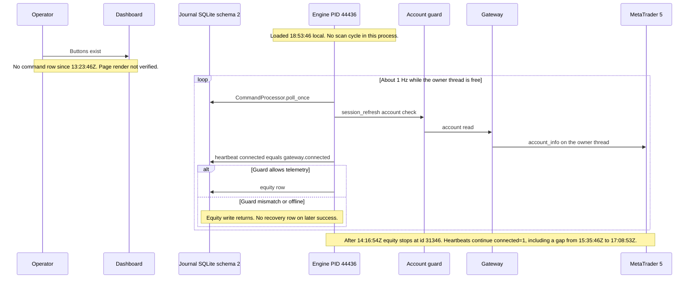

# Runtime architecture — current

Written 2026-10-16. Two clocks matter.

The running process is PID 44436, started 15-10-2026 18:53:46, command
`python -u -m engine`, mode PAPER. That process loaded the code that
existed at start. Commit `457d3f9` (Stage 1) was written later.
`engine/scan_cycle.py` was last written at 15-10-2026 20:16:11, after
the process start. The diagram below is the path that process is
running.

The source tree on `feature/echofi-ui` is newer. `Engine.run_once` in
the tree calls `_scan_cycle()` after the heartbeat. `_scan_cycle` returns
immediately when `self.scanner is None`. PID 44436 never constructed the
Stage 1 scanner, because that construction was not in the module it
loaded. Stage 1 is documented in `docs/Stage1_Implementation_Report.md`.
It is not part of this running sequence.

## Sequence — PID 44436



Startup of this process also wrote, once each: gateway connected
(event 23626), telegram initialized (23627), telegram approval layer
enabled (23628), backup database backed up (23629). Those are not on the
per-iteration arrow.

`ai_brain.py` does not appear in the sequence. Evidence is in the next
section.

## ai_brain.py is not used by engine execution

PROVEN from the tree on 2026-10-16, and consistent with the process that
is running. PID 44436 started before commit `474efd7`, which only changed
the module docstring. The import graph did not include this module
before that commit either.

Evidence:

1. Commit `474efd7` (`docs: deprecate ai_brain.py without deleting it`)
   replaces the opening docstring. The diff is:

```
-"""LLM validation layer.
+"""DEPRECATED. Do not delete this module without a review.
+
+Not used by the engine. Not used by the UI. Retained temporarily.
+Retirement is planned after the migration and its tests are in place.
+Importing it from ``engine/`` or ``ui/`` is a mistake. The remaining
+imports are in tests. ``scripts/mutation_check.py`` names this file as a
+mutation target and does not import it.
+
+LLM validation layer.
```

2. A search on 2026-10-16 for `from ai_brain` and `import ai_brain` under
   `engine/` and `ui/` returned no matches.
3. The remaining imports are in `tests/test_llm_validator.py` and
   `tests/test_metrics.py`. `tests/test_ui/test_no_vendor_names.py`
   mentions the name in a string and asserts the rendered UI does not
   contain it.
4. `scripts/mutation_check.py` sets `target="ai_brain.py"` in several
   mutation entries. That names a file. It does not import the module
   into the engine loop.
5. `engine/brain.py` is not a file in this repository. An older diagram
   that drew `ai_brain` into the execution engine is marked retired in
   `docs/Architecture_Audit_Report.md`. The ownership table that matches
   PID 44436 is `docs/Ownership_Table.md` (updated in commit `94b7511`).

The module still contains `apply_llm_adjustment()` and
`get_ai_decision()`. Nothing in `Engine.run_once` calls them.

## Ownership matrix

Owner is the component that writes or decides. "This run" means PID
44436 from `2026-10-15T13:23:46+00:00` through the 2026-10-15 reads.
The journal was not re-queried on 2026-10-16.

| Path | Owner | This run |
|---|---|---|
| Operator clicks Emergency Stop or Enable AI | Dashboard enqueues; engine polls | Buttons not exercised. Poll is running. |
| `commands` insert | `ui/components/emergency_stop.py`, `ui/components/enable_ai.py` | No row with `ts >= 2026-10-15T13:23:46+00:00`. Count 0. |
| `CommandProcessor.poll_once` | Engine, first step of `run_once` | Running. Empty queue. |
| Account read | Gateway, on the engine owner thread | Running until the outage. After 14:16:55Z the engine event stayed unresolved. |
| Heartbeat row | Engine `state.heartbeat(connected=gateway.connected)` | Running. 3056 rows in the clean window, all `connected=1`. Continued after the outage, with one unexplained gap. |
| Equity / telemetry row | Engine `_write_telemetry`, gated by `guard.may_write_telemetry()` | Running until equity id 31346 at 14:16:54Z. Then stopped. |
| Terminal-offline event | Account guard, severity WARNING, `kind=terminal_offline` | Running. Event 23630 and reminders 23631–23637. |
| Recovery event | Not implemented. `check()` success clears `_active_reason` and writes nothing. | No row. |
| Real account mismatch | Account guard, severity CRITICAL, `kind=account_mismatch` | Not produced this run. Historical archive row exists. See the A1 note. |
| Order send | Gateway `send_order` | Not exercised this run. `PROBE_POS 0`. Magic 234000 count was 0 and was not touched. |
| Stage 1 scan | `ScanCycle` inside `run_once` after the heartbeat, in commit `457d3f9` | Not in PID 44436. Tested on temporary databases only. |
| `ai_brain.py` | Nobody in the engine or the UI | Not on the execution path. |
| `engine/brain.py` | Nobody | File does not exist. |
| Research Desk shadow loop | `learning/runtime.py` when `data/shadow_mode.on` exists | `config_ext.yaml` `shadow.enabled: false` is loaded and ignored (commit `3aaf8b6`). Not the engine loop. |
| Telegram approval events 23625 and 23628 | Optional startup layer | Initialized at startup. Not an `approve_first` config key. |
| UI `system_status()["scan_loop"]` | `ui/data_access.py` returns the literal `"Not built yet"` | Stale relative to committed Stage 1. Not changed. The UI read path was not exercised against the new scanner. |

## Wired and running

These ran inside PID 44436 and left journal evidence:

- Command poll every iteration. Evidence: the loop order in the code the
  process loaded, and a clean soak with zero command rows rather than a
  stuck poll error.
- Session-refresh account check. Evidence: event 23630,
  `phase=session_refresh`, `kind=terminal_offline`.
- Heartbeat write. Evidence: `HB_COUNT (3056, 0, 0)` in the clean window,
  then later ids through 57799 at `2026-10-15T17:15:01+00:00`.
- Equity write until the guard closed telemetry. Evidence: `EQ_COUNT
  (3056, 28291, 31346, ...)`, then no higher equity id.
- Offline detection and 10-minute reminder while the owner thread was
  making progress. Evidence: 23630 at 14:16:55Z, then 23631–23634 on a
  10-minute spacing.
- Single-instance lock. Evidence: a later read of the lock file raised
  `PermissionError` `[Errno 13]`, and a repository search on 2026-10-16
  skipped `data\engine_5057151780.lock` with os error 33. The exact
  locked byte was not printed. A byte-0 probe that prints `LOCK_FREE`
  does not prove the lock is absent: the locker writes the PID after
  locking one byte at the then-current offset.

## Wired but never exercised

This run, meaning no journal evidence that the path fired:

- Dashboard Emergency Stop and Enable AI. Enqueue sites exist. Command
  count since 13:23:46Z is 0. Historical `ENABLE_AI` rows from
  2026-10-13 are a different run.
- `send_order` / `order_send`. Positions observed: 0.
- The CRITICAL account-mismatch branch. This run's outage was
  `terminal_offline` at WARNING, because no account was logged in.
- Live Streamlit render of the severity badge. The HTML unit test
  passed. The page was not opened.

## Not wired

- `ai_brain.py` into `Engine.run_once` or any `engine/` or `ui/` import.
- `engine/brain.py`. No such module.
- A recovery event when `account_info()` starts returning the expected
  account again.
- `approve_first`, `auto_execute`, and `execution_mode` as keys the
  running process reads. A search of `*.py`, `*.yaml`, and `*.yml` on
  2026-10-16 found none. The phrases exist in design notes
  (`docs/Instructions_2.md`, `docs/Phase2A_Scan_Loop_Design.md`). Telegram
  approval-layer startup events are a different mechanism.
- `config_ext.yaml` key `shadow.enabled` into `learning.runtime`. Commit
  `3aaf8b6` records that the value is loaded and then ignored. The
  Research Desk toggle file `data/shadow_mode.on` is what starts a cycle.
  The flag was not wired.

## Not verified

- Stage 1 on PID 44436. The code exists in `457d3f9`. This process does
  not have it. Live `schema_version` rows are version 1 and version 2,
  both stamped `2026-10-13T19:51:15+00:00`. There is no `scan_symbols`
  table on the live file from the read-only extract. `COUNT(*)` from
  `scan_results` was 0, and the live columns were still `id`,
  `symbols_json`, `ranked_json`, `ts`.
- Opening `engine.journal.Journal` on the live file. `SCHEMA_VERSION` is
  3. Constructing `Journal` migrates. That was not done, because PID
  44436 is still writing schema 2.
- Cause of the heartbeat gap 57478 (`2026-10-15T15:35:46+00:00`) to 57479
  (`2026-10-15T17:08:53+00:00`): now PROVEN as Windows Modern Standby
  sleep/wake, matching the MT5 disconnect/re-authorization logs. No blocked
  owner-thread call is attributed to this interval.
- Cause of reminder gaps after `2026-10-15T14:56:57+00:00`.
- The live dashboard badge for a stored CRITICAL row.
- Whether a second engine would be refused. The lock is held. A second
  engine was not started.

## What the on-disk loop would add after a future start

Not loaded. Listed so the diagram is not mistaken for the source tree.

`engine/__main__.py` `run_once` order in the tree:

1. `self.commands.poll_once()`
2. Account transition check and `_verify_account("session_refresh")`
3. `self.state.heartbeat(connected=self.gateway.connected)`
4. `self._write_telemetry()`
5. `self._scan_cycle()`

`build_engine` constructs `ScanCycle(symbols=list(config.scan_symbols),
max_scan_seconds=float(config.max_scan_seconds))`. A future process that
loads this module would call that scanner after each heartbeat.
PID 44436 will not, until it is restarted. It was not restarted.
